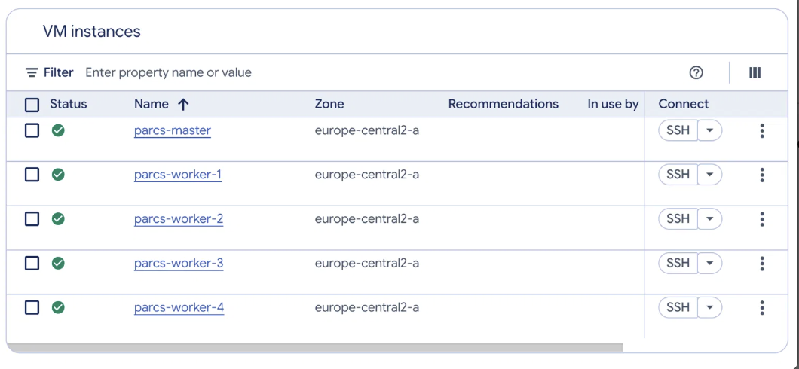
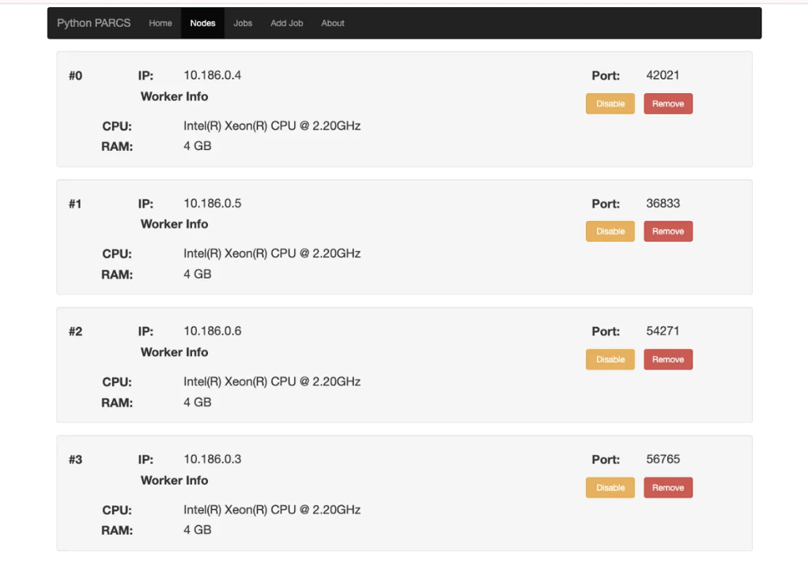
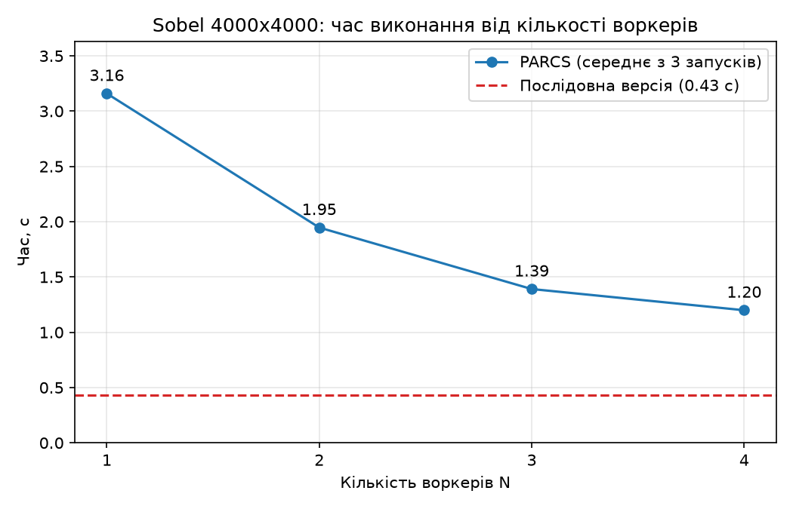
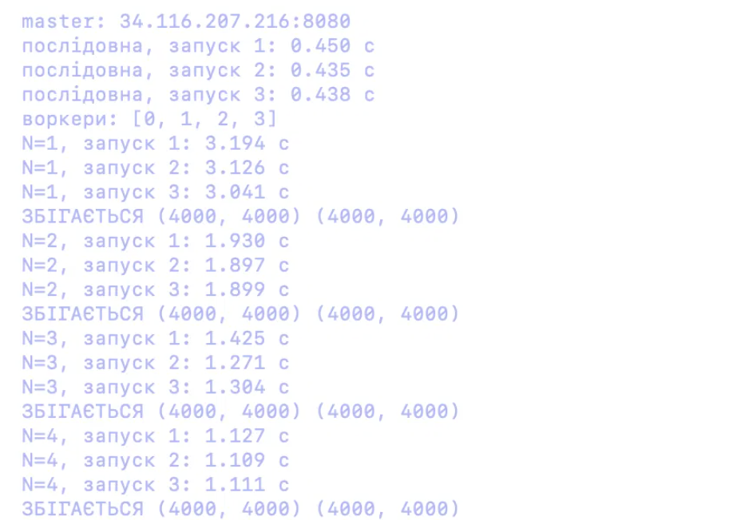
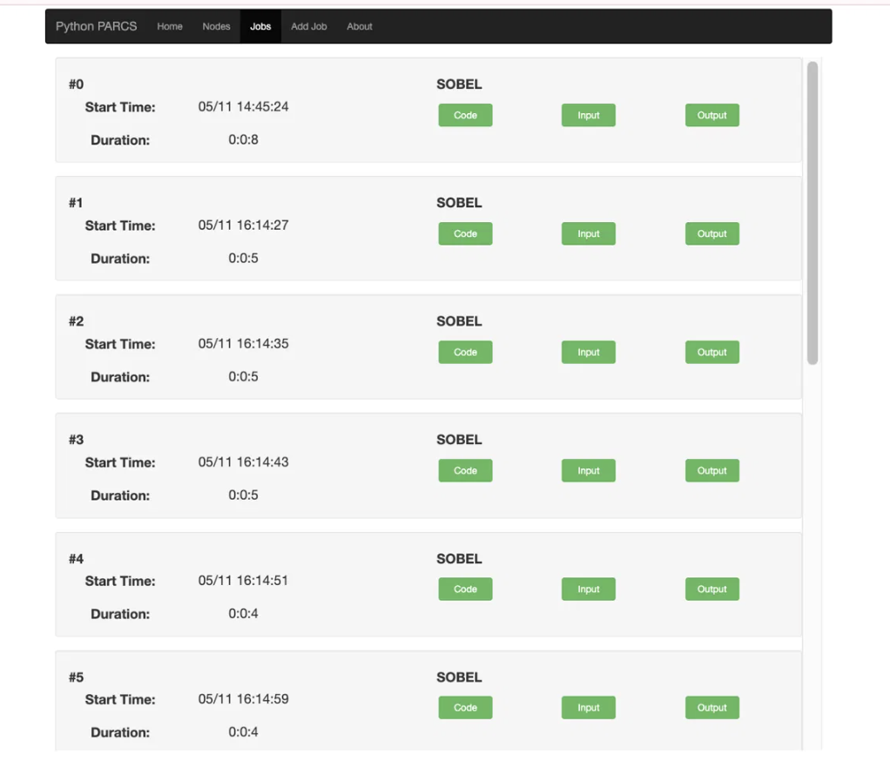
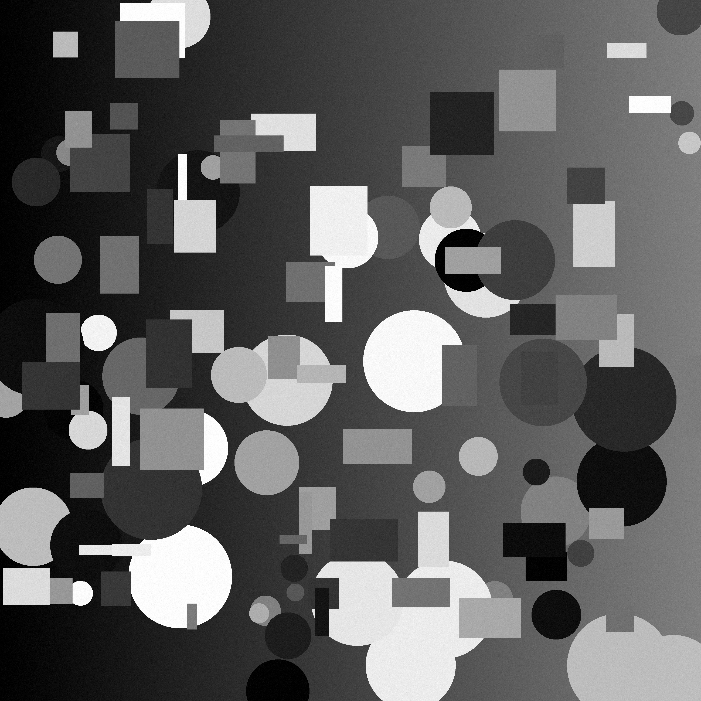
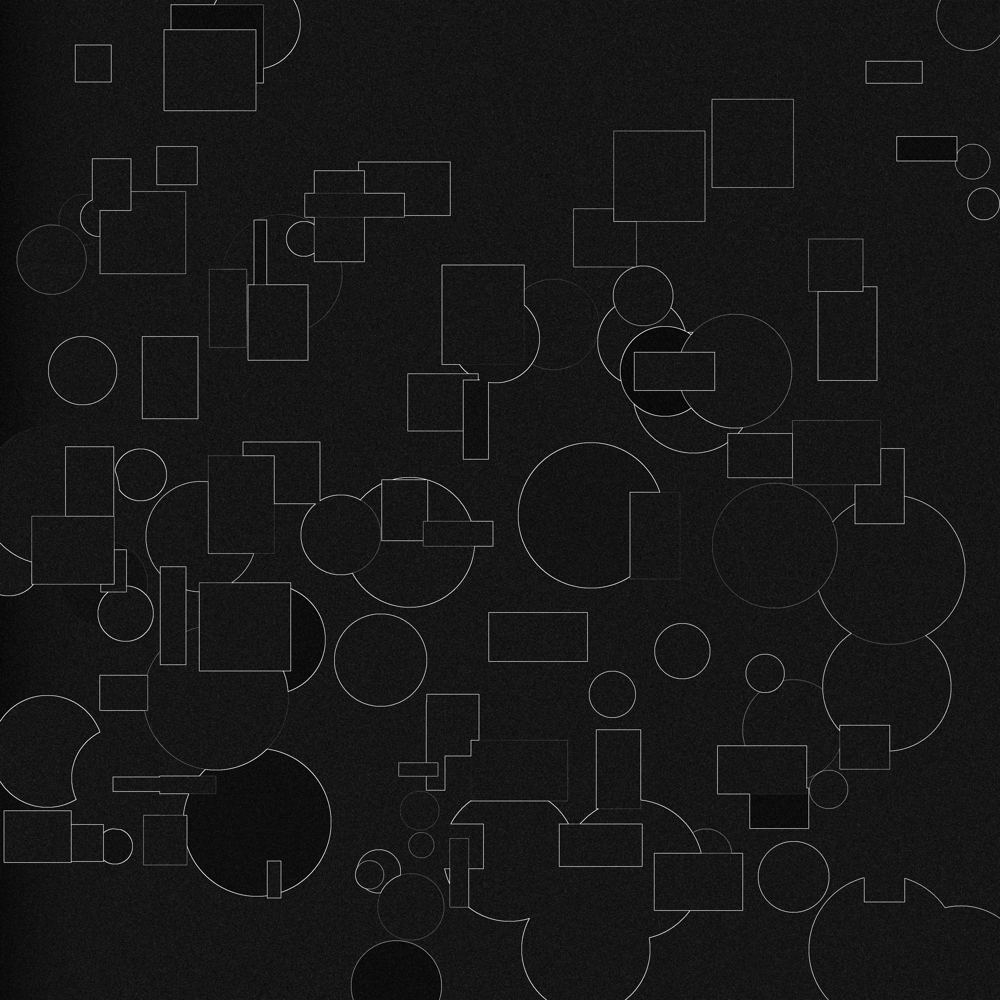

# Паралельне виявлення контурів (Sobel) на PARCS-Python у Google Cloud

**Виконала:** Лисенко Катерина, група ТТП-42  
**Тема:** 5.3 — паралельний оператор Собеля

Лабораторна «Хмарні обчислення». Зображення 4000×4000 ділиться між воркерами PARCS, кожен рахує оператор Собеля через numpy, master склеює результат.

Репозиторій: **https://github.com/succunstonnnnnn/parcs-sobel** (див. розділ 6)

```
docker/      копія платформи Hummer12007/parcs-python (https://github.com/Hummer12007/parcs-python) + змінений Dockerfile
sobel/       solution.py (PARCS-модуль), sobel_seq.py (послідовна версія), make_image.py, compare.py
scripts/     setup.sh, start.sh, stop.sh, cleanup.sh, startup.sh, config.sh, run_job.py, benchmark.py, plot.py
images/      input.png (вхід), output.png (результат PARCS), output_seq.png (результат послідовної версії)
results.json, results.png   результати замірів і графік
screenshots/ скриншоти консолі GCP, веб-інтерфейсу PARCS і виводу benchmark.py
```

## 1. Ідея алгоритму і паралелізації

**Sobel.** Для кожного пікселя беремо його 8 сусідів і рахуємо два числа: `gx` (наскільки яскравість змінюється зліва направо) і `gy` (зверху вниз). Для цього використовуються ядра:

```
gx: -1 0 1      gy: -1 -2 -1
    -2 0 2           0  0  0
    -1 0 1           1  2  1
```

Яскравість контуру в пікселі = `sqrt(gx² + gy²)`, обрізана до 0…255. Де різка зміна яскравості, там світлий піксель.

**Чому це добре паралелиться.** Результат кожного пікселя залежить лише від його сусідів у вхідній картинці й не залежить від інших результатів. Тому картинку можна розрізати на частини, і частини рахуються незалежно.

**Схема (master / worker):**

1. Master читає PNG у сірому кольорі й додає рамку в 1 піксель (краї дублюються), щоб у крайніх пікселів теж були сусіди.
2. Master ділить `H` рядків на `N` горизонтальних смуг (`N` = кількість воркерів). Кожна смуга береться з **перекриттям у 1 рядок** зверху і знизу: щоб порахувати рядки `a…b`, потрібні рядки `a-1…b+1`. Без перекриття на межах смуг з'явилися б «шви».
3. Master надсилає смуги воркерам (виклики асинхронні, тож усі воркери працюють одночасно).
4. Кожен воркер рахує Sobel своєї смуги через numpy і повертає масив.
5. Master склеює смуги зверху вниз (`np.vstack`) і зберігає `output.png`.

Функція Sobel однакова в `sobel_seq.py` (послідовна версія) і в `solution.py` (воркер), тому результати збігаються **піксель у піксель**. Це перевіряє `sobel/compare.py`: для N=1,2,3,4 виводилось «ЗБІГАЄТЬСЯ».

**Що вимірюється.** Час від розсилання смуг до отримання і склеювання результату. Читання і запис PNG не входять ні в послідовну, ні в паралельну версію. Тобто в PARCS-час входить і передача даних по мережі.

## 2. Помилки збірки PARCS через застарілі версії і як їх виправили

Платформа PARCS-Python написана на Python 2.7 з 2018 року, а інструкція в її README описує застарілі способи. Нижче тільки помилки, які реально трапились під час роботи.

| № | Що сталось | Причина | Виправлення |
|---|-----------|---------|-------------|
| 1 | Методичка за посиланням `.../PARCSPython_Google_Cloud_0925.pdf` віддала **404 Not Found** | Файл прибрали або перемістили | Розгортала за README платформи; якщо у вас є актуальне посилання, звіряйтеся з ним |
| 2 | `docker build` за оригінальним `Dockerfile` падає: `apt-get update` → `404 Not Found`, `The repository ... stretch/updates Release does not have a Release file` | Базовий образ `debian:stretch-slim`: репозиторії Debian 9 давно переміщені в архів | Базовий образ замінено на `python:2.7-slim` (Python 2.7 уже всередині, `apt-get` не потрібен) |
| 3 | Контейнер падає на старті: `ImportError: No module named cpuinfo` (файл `node_info.py`) | `pip install py-cpuinfo` ставить останню версію 9.0.0, яка не працює під Python 2.7 | Версію зафіксовано: `py-cpuinfo==5.0.0` |
| 4 | `gcloud compute instances create-with-container ...` (команда з README): `ERROR: You are creating a container VM. The option to deploy a container during VM instance creation ... is discontinued` | Google вимкнув створення VM із контейнером | Звичайна VM з образом `cos-stable` (Container-Optimized OS); образ і аргументи PARCS передаються в метаданих, а `scripts/startup.sh` при кожному старті VM запускає `docker run` |
| 5 | VM працюють, але веб-інтерфейс `:8080` не відкривається, воркери не реєструються на master (хоча фаєрвол GCP відкритий) | У Container-Optimized OS є власний `iptables` (політика `INPUT DROP`, відкритий лише ssh) | У `startup.sh` додано правила: дозволити весь трафік із `10.0.0.0/8` (воркери ↔ master) і порт 8080 |
| 6 | Задача падає: `AttributeError: 'NoneType' object has no attribute 'mymap'` | У `scheduler.py` викликається `Pyro4.async(proxy)`, який **перетворює сам proxy на асинхронний і повертає `None`**. Я спочатку використала його результат | Викликаю `self.workers[i].mymap(...)` напряму; результат читається через `.value` |

Слово `async` у `scheduler.py` стало ключовим у Python 3.7+, тому платформа не запуститься на сучасному Python. Лишаємось на Python 2.7 у контейнері, `solution.py` теж Python 2.7, numpy 1.16.6 (остання версія для Python 2.7).

Також: образ `hummer12007/parcs-node` з README не підходить, бо в ньому немає numpy, тому збираємо власний образ і кладемо його в Google Artifact Registry.

## 3. Мінімальний гайд: як повторити в GCP

Потрібно: встановлені й залогінені `gcloud` і Docker (Docker Desktop має бути запущений), проєкт із увімкненим білінгом, Python 3.

```bash
# 0. Клонуємо репозиторій і задаємо свій проєкт та зону
git clone https://github.com/succunstonnnnnn/parcs-sobel.git && cd parcs-sobel
gcloud auth login
nano scripts/config.sh          # змініть PROJECT (і за потреби REGION/ZONE)

# 1. Створюємо все: репозиторій образів, образ, фаєрвол, 1 master + 4 workers (e2-medium)
#    (скрипти написані під bash — запускайте їх як ./scripts/...; у zsh на Mac не копіюйте з них цикли в термінал напряму)
./scripts/setup.sh

# 2. Дізнаємось зовнішню IP master і перевіряємо, що воркери зареєструвались
MASTER_IP=$(gcloud compute instances describe parcs-master --zone europe-central2-a \
  --format="value(networkInterfaces[0].accessConfigs[0].natIP)")
curl http://$MASTER_IP:8080/api/worker          # має бути 4 воркери
# веб-інтерфейс: http://$MASTER_IP:8080

# 3. Готуємо Python-середовище, генеруємо картинку і запускаємо одну задачу
python3 -m venv .venv && .venv/bin/pip install numpy pillow matplotlib
.venv/bin/python sobel/make_image.py images/input.png
.venv/bin/python scripts/run_job.py $MASTER_IP:8080 sobel/solution.py images/input.png images/output.png

# 4. Повні заміри (послідовна + N=1..4, по 3 запуски) і графік
.venv/bin/python scripts/benchmark.py
.venv/bin/python scripts/plot.py

# 5. Зупинити VM (щоб не платити за обчислення) і знову запустити
./scripts/stop.sh
./scripts/start.sh              # сам чекає, поки PARCS знову запрацює, і друкує нову IP master

# 6. Видалити все, коли лабу здано (спитає підтвердження)
./scripts/cleanup.sh
```

Нюанси:

- **Після `start.sh` PARCS працює сам.** Воркери підключаються до master за його *внутрішньою* IP, а вона не змінюється при stop/start. Контейнери піднімає `startup.sh`, воркери самі перереєструються. Змінюється лише зовнішня IP master, її друкує `start.sh`. `start.sh` також оновлює правило фаєрвола під вашу поточну публічну IP.
- Фаєрвол `parcs-web` пускає на порти 8080 і 22 лише з вашої IP, тому з іншої мережі веб-інтерфейс не відкриється. Повторіть `./scripts/start.sh` або оновіть правило вручну.
- Ціна: приблизно $0,25–0,30 за годину за 5 × e2-medium; у зупиненому стані коштують лише диски.





## 4. Результати

Тестове зображення: `images/input.png`, 4000×4000, 8 біт, сіре (згенероване `make_image.py`). VM: `e2-medium` (2 vCPU, 4 ГБ). Послідовна версія виміряна на VM `parcs-worker-1` у тому самому Docker-образі. Кожне значення — 3 запуски, нижче середнє.

| Варіант | Запуск 1, с | Запуск 2, с | Запуск 3, с | **Середнє, с** | Прискорення відносно N=1 | Прискорення відносно послідовної | Ефективність E = S/N |
|---|---|---|---|---|---|---|---|
| Послідовна (без PARCS) | 0,450 | 0,435 | 0,438 | **0,441** | — | 1,00 | — |
| PARCS, N=1 | 3,194 | 3,126 | 3,041 | **3,120** | 1,00 | 0,14 | 1,00 |
| PARCS, N=2 | 1,930 | 1,897 | 1,899 | **1,909** | 1,63 | 0,23 | 0,82 |
| PARCS, N=3 | 1,425 | 1,271 | 1,304 | **1,333** | 2,34 | 0,33 | 0,78 |
| PARCS, N=4 | 1,127 | 1,109 | 1,111 | **1,116** | 2,80 | 0,40 | 0,70 |

Для N=1,2,3,4 результат PARCS збігається з послідовним піксель у піксель (`compare.py`: «ЗБІГАЄТЬСЯ (4000, 4000)»).

**Висновки.**

- Масштабування за кількістю воркерів є: від N=1 до N=4 час зменшився з 3,12 до 1,12 с (в 2,80 раза). Зростання менше за ідеальне ×4: послідовні частини виконує сам master (нарізка смуг, кодування в base64, розсилання через один мережевий канал, склеювання через `np.vstack`), і за законом Амдала вони обмежують прискорення. Ефективність падає з 1,00 до 0,70 при N=4.
- **Але послідовна версія швидша за PARCS при будь-якому N** (0,44 с проти 1,12 с). Це чесний результат, його не потрібно приховувати. Саме обчислення Sobel у numpy дуже швидке (долі секунди), тож розпаралелювати майже нічого. Для PARCS доводиться пересилати ~16 МБ даних на воркерів і стільки ж назад, причому у вигляді тексту base64 (≈21 МБ у кожен бік) через Pyro4 на Python 2. N=1 це добре показує: обчислення те саме, а час у 7 разів більший. Імовірно, саме пересилання і кодування становить основну різницю (окремо я це не профілювала).
- PARCS виграв би, якби обчислення на один піксель було набагато важчим, ніж передача даних (наприклад, багатокрокова обробка або значно більші зображення).

## 5. Графік



Суцільна лінія: PARCS, середнє з 3 запусків; пунктир: послідовна версія.





Вхідне й результуюче зображення (`images/input.png` і `images/output.png`):

| Вхід | Результат Sobel |
|---|---|
|  |  |

## 6. Посилання на репозиторій

https://github.com/succunstonnnnnn/parcs-sobel

Папка `docker/` — копія платформи [Hummer12007/parcs-python](https://github.com/Hummer12007/parcs-python) (оригінал: https://github.com/Hummer12007/parcs-python) із зміненим `Dockerfile` (див. розділ 2).
